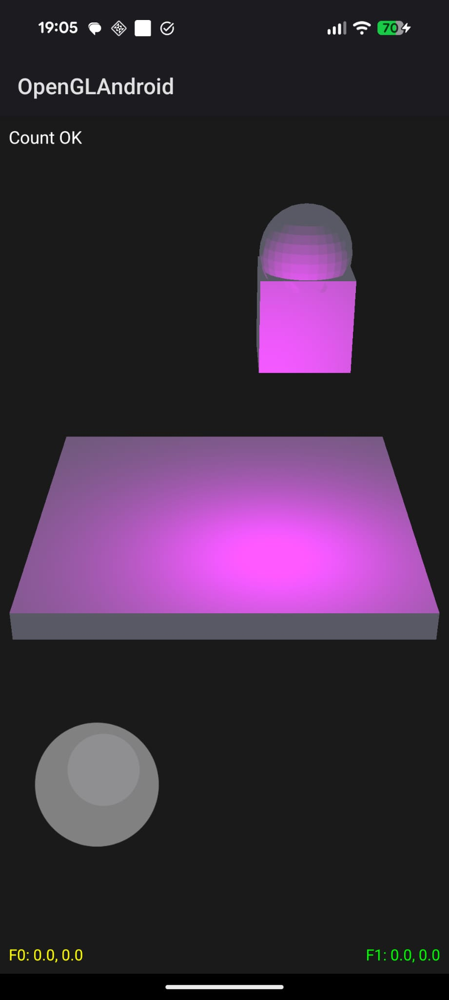

# 📱 Android NDK 3D OpenGL ES Engine

A high-performance mobile Native C++ 3D Graphics Engine built using **Android NDK**, **OpenGL ES 3.0**, **EGL**, **GLM**, and **JNI**. Designed for low-latency rendering, modular scene object management, dynamic lighting, and custom multi-touch screen controls.

---

## 🌟 Key Architecture & Highlights

### 📱 **Native C++ Performance (NDK & JNI)**
- **100% C++ Engine Core**: Rendering pipeline, object manager, input handling, and scene logic run natively in C++.
- **Zero-Copy Asset Loading**: Custom C++ shader and model loading directly from APK assets via Android `AAssetManager` JNI bridge.
- **Java/Kotlin Bridge**: Minimal `GLSurfaceView` and `MainActivity` shell handling native lifecycles (`initEngine`, `resizeEngine`, `renderEngine`).

### 🕹️ **Custom Multi-Touch 2D Virtual Joystick**
- **Touch Input Handler**: Native `TouchInput` system handling multi-finger touch coordinates and gestures (`nativeOnTouch`).
- **Dynamic 2D Joystick Overlay**: Dual-layer joystick (`LeftBackgroundStick` & `LeftFrontStick`) rendered using an orthographic projection quad overlaid on top of 3D scene.

### 💡 **Lighting & Shader Pipeline**
- **OpenGL ES 3.0**: GLSL ES 300 vertex and fragment shaders (`ModelShader.vs/fs`, `joystick_shader.vs/fs`).
- **Lighting Models**: Directional sun lighting (`SunLight`), ambient, specular, and diffuse reflection.
- **Dual-Pass Rendering**: 3D Perspective projection for scene objects + 2D Orthographic projection for UI elements.

### 🧱 **Modular Object Manager**
- **Scene Switching**: Easy creation and switching of modular C++ scenes (e.g., `createOriginalScene` with players and lights vs. `createCubeScene`).
- **Entity Life Cycle**: `ObjectManager` controlling update loops (`updateAll()`), draw calls (`drawAll()`), and window resizing (`resize()`).

---

## 📸 Preview



---

## ⚔️ Comparison: Desktop Engine vs. Android NDK Engine

| Feature / Aspect | 🖥️ Desktop Engine (`/Desktop-Engine`) | 📱 Android NDK Engine (`/Android-NDK-Engine`) |
| :--- | :--- | :--- |
| **Primary Platform** | Desktop (Windows / Linux / macOS) | Mobile (Android NDK Native C++) |
| **Graphics API** | Desktop OpenGL 3.3 Core Profile | OpenGL ES 3.0 (Mobile GPU optimized) |
| **Windowing System** | GLFW (Desktop window & context creation) | Android `GLSurfaceView` + EGL native surface |
| **Input Mechanism** | Physical Keyboard (WASD/Arrows) & Mouse | Multi-Touch Touchscreen with custom C++ 2D Virtual Joystick |
| **Asset Pipeline** | Direct File System + Assimp OBJ/MTL Loader | Android `AAssetManager` C++ JNI bridge directly from APK `assets/` |
| **Projection Pipeline** | 3D Perspective Projection | Dual Projection (3D Perspective for world + 2D Orthographic overlay for UI) |
| **Project Focus** | 3D Drone Flight Simulation & CGAL Physics | Low-latency Mobile Native Performance, Touch Controls & Modular Scene Architecture |

---

## 📁 Project Structure

```
Android-NDK-Engine/
├── app/
│   ├── src/main/
│   │   ├── cpp/                    # Native C++ Engine Code
│   │   │   ├── native-lib.cpp      # JNI Entry points & Engine Initialization
│   │   │   ├── globals.h / .cpp    # Engine global pointers and window dimensions
│   │   │   ├── input/              # Multi-Touch Touchscreen System (touch_input.h/cpp)
│   │   │   ├── renderer/           # Shader compilation & Vertex structures (shader.h/cpp, vertex.h)
│   │   │   ├── scene/              # Scene Entities & Managers
│   │   │   │   ├── object_manager.h# Master Scene Object Manager
│   │   │   │   ├── camera.h        # 3D View/Projection Matrix Camera
│   │   │   │   ├── player.h        # 3D Player Entity
│   │   │   │   ├── joystick.h      # Virtual Joystick base class
│   │   │   │   ├── left_background_stick.h / left_front_stick.h # Joystick 2D Quads
│   │   │   │   ├── sunlight.h      # Directional Sun Light
│   │   │   │   └── cube_object.h   # 3D Cube Scene Object
│   │   │   └── external/glm/       # OpenGL Mathematics Library
│   │   ├── assets/                 # Shaders and Texture assets bundled into APK
│   │   ├── java/com/example/openglandroid/ # Android Activity & GLSurfaceView Shell
│   │   └── res/                    # Android App Resources & Layouts
└── build.gradle                    # Gradle Build Configuration
```

---

## 🚀 How to Build & Run

1. Open `Android-NDK-Engine/` in **Android Studio**.
2. Ensure **Android NDK** and **CMake** are installed via SDK Manager.
3. Sync Gradle project.
4. Select a physical Android device or Emulator (with OpenGL ES 3.0 support).
5. Press **Run (Shift+F10)** to compile C++ native library and deploy APK.
